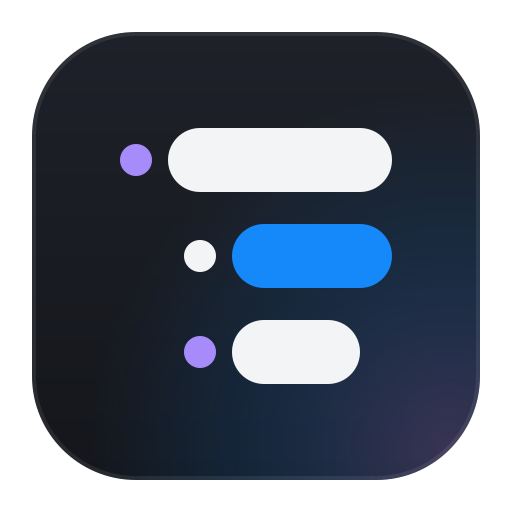
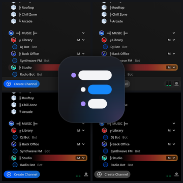
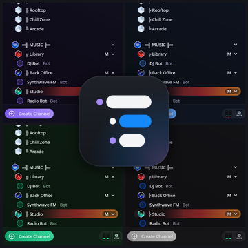

# TeamSpeak 6 Themes

**Compact TeamSpeak 6 themes with the feel of TeamSpeak 3.** Tight channel
rows, small icons and no wasted space, so your whole server fits on screen
again. Two themes, eight color variants.

🌐 **[Website with a live preview of every variant (English / Deutsch)](https://ritze03.github.io/Teamspeak6Themes/)**
· **[⬇ Download (ZIP)](https://github.com/Ritze03/Teamspeak6Themes/archive/refs/heads/master.zip)**
· **[How to install](#how-to-install)**

  
  

Channel tree sizing: 28px rows, 22px icons, 13px font, 2px gap between
channels.

## Graphite — compact & dark

A clean dark-gray look with a compact server tree, so more channels and
users fit on your screen. Colored icons and talking indicators stay just
like you know them.

| Variant | Look |
|---|---|
| Vanilla | Gray backgrounds, normal TeamSpeak colors, blue buttons |
| Vanilla Monochrome | Buttons and highlights turn gray too — only icons stay colored |
| Amoled | Pitch black, perfect for OLED screens |
| Amoled Monochrome | Pitch black with gray accents, like Vanilla Monochrome |
| … - NoScroll | The same four, but without scrollbars in the channel tree and chat |

## Aurora — glassy & glowing

Frosted, semi-transparent panels floating over soft glowing lights, with
the same compact server tree as Graphite.

| Variant | Look |
|---|---|
| Violet | Violet, cyan and pink glow |
| Blue | Deep blue night |
| Green | Emerald northern lights |
| Monochrome | Silver glow, gray accents |
| … - NoScroll | The same four, without scrollbars in the channel tree and chat |

## How to install

1. **[⬇ Download the themes (ZIP)](https://github.com/Ritze03/Teamspeak6Themes/archive/refs/heads/master.zip)**
   and unpack the file somewhere.
2. Open TeamSpeak and go to **Settings → Appearance**.
3. Turn on the **User Theme** toggle.
4. Click the small **folder icon** next to the theme cards. TeamSpeak opens
   its **extensions** folder for you.
   - Linux: usually `~/.config/TeamSpeak/Default/extensions`
   - Windows: usually `%APPDATA%\TeamSpeak\Default\extensions`
5. Move (or copy) the folders **`de.wurst.graphite`** and
   **`de.wurst.aurora`** from the unpacked download into that extensions
   folder. You can also install just one of them.
6. Back in TeamSpeak, click the small **refresh icon** (circular arrow) next
   to the folder icon — the new themes appear as cards.
7. Click the theme you like.
8. **Restart TeamSpeak** — the channel tree only applies its sizing
   properly after a restart. Done!

## Good to know

- The themes are designed for the **"Compact"** setting under
  **Settings → Appearance → Tree Style**, but they also work with
  "Detailed".
- **Restart TeamSpeak once when you switch to these themes** from
  TeamSpeak's own look or another theme (and again when you switch back).
  The channel tree only updates its sizing after a restart; until then the
  channel list may look squished or oddly spaced. Switching between
  Graphite and Aurora variants works right away, since they all share the
  same sizing.
- Updating: replace the two folders with new versions, then press the
  refresh icon (or restart TeamSpeak). If a new version renamed or added
  variants, TeamSpeak may switch to another theme or turn User Theme off;
  just pick yours again.
- Uninstalling: delete the folders from the extensions folder.
